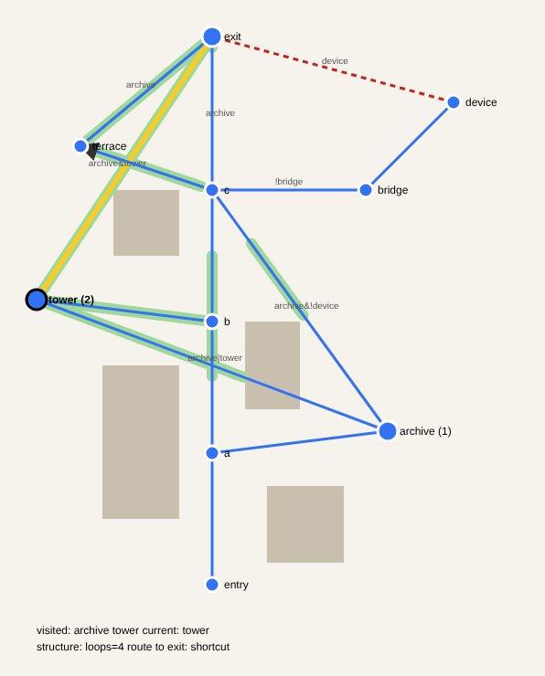

# 廃墟の都市を探索する ― 授業設計メモ

## ストーリー
プレイヤーは見知らぬ都市の入口に到着する。都市には 3 つの目的地がある。

- **Archive**:過去の情報が残された場所
- **Tower**:都市全体を見渡せる場所(Landmark)
- **Exit**:都市から出る場所

最初はすべての経路が通れるわけではない。ある場所で情報を得ると、別の場所への経路が開く。
訪問の順序によって、都市の **形ではなく接続関係** が変わる。

## 課題と空間構造

| 段階 | ストーリー上の出来事 | 学習する空間構造 | Houdini での作り方 |
|---|---|---|---|
| C03–C04 | 鍵を見つけて扉を開く | Tree・分岐 | タグ + Split |
| C04 | Archive を訪れると Tower への別経路が開く | 条件付き接続 | 「archive 訪問後」に開くゲート |
| C04 | 両方を訪れると Exit へのショートカット | Loop・Semilattice | 両方そろうと開くゲート |
| C04 | 古い橋を渡ると崩れる | 接続の消失 | 訪問すると閉じるゲート |
| C04 | 装置を操作すると別の扉が閉じる | 排他的な接続 | 2 つのゲートを排他にする |
| C06 | 高所へ上がると戻れない | Directed Path | 一方通行(Directed Primitives) |
| Sample 5 | Tower を見て方向を把握する | Landmark・視認性 | 経路上の各点で Tower が見えるかを色分け |

## 時間と順序の表し方
Houdini のネットワークには時間がないので、時間をシミュレーションする代わりに
**訪問履歴を入力として都市の状態を再計算する**。CTRL の情報を 3 つに分ける。

```
visited    = archive tower   # 過去の行為(訪れた順)
current    = tower           # 現在位置
gate_state = (visited から計算される現在の接続状態)
```

- 各ゲートの Switch が visited を見て開閉を決める。
- visited を 1 語ずつ書き足すと、その時点で行ける範囲(reach)が変わる。
- 開いている道だけで閉路を数えると、Tree(閉路 0)から Loop へ変わる瞬間が確認できる。

参照実装:[`houdini/ruined_city.py`](../houdini/ruined_city.py)
(Python SOP。`PLACES` / `PATHS` / `OBSTACLES` を書き換えると自分の都市になる)

```bash
python houdini/ruined_city.py --visited "archive tower" --svg city.svg
```



青 = 現在位置から行ける場所/道、灰 = 開いているが行けない道、赤の破線 = 閉じたゲート、
黄 = Exit への最短経路、緑の帯 = Tower が見える区間、矢印 = 一方通行。

## 最終課題
「ひとつの都市を生成する」ではなく、**「行為によって接続関係が変化する都市を設計する」**。
学生は接続・制限・分岐を自分で設計し、接続を切れば Tree に戻り、
接続を足せば複数の経路が重なる(Semilattice)ことを操作して確かめる。

## 注意:歴史的空間との関係
「空間は人間の選択を可能にするのか、制限するのか」という問いは、
アウシュビッツやゲットーのような歴史的空間を考えることにつながる。
ただし、**遊べるサンプルはあくまで架空の廃墟都市にとどめる**。
実在の場所をゲームのステージにしたり、「取り消せない選択」の仕組みを実在の犠牲者に
直接結びつけたりすると、歴史を軽く扱うことになりかねない。
歴史的空間は、講義・文献・議論の場で別に扱う。
